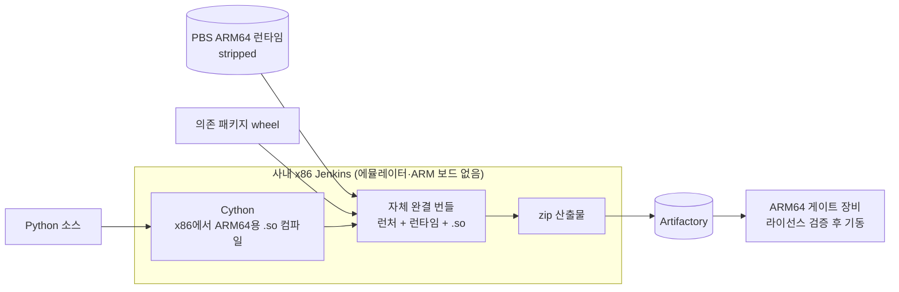

**기간** 2026.06 · **역할** 4가지 방식 구현·실측·비교, 최종안 설계 · **스택** Python, Cython, Nuitka, PyInstaller, python-build-standalone(PBS), Jenkins

> **기여도** — 빌드·패키징·CI 부분 100% 본인 (비교 보고서, 크로스컴파일 설계, Jenkins 파이프라인, 라이선스 검증 기동 게이트). 제어 프로그램 본체는 개발팀 코드이며, 저장소 전체 기준으로는 커밋 33/75(44%), 변경 5,099/15,485줄(32%).

## 배경

출입 게이트에 들어가는 ARM64 보드용 Python 제어 프로그램을 **다른 회사에 납품**해야 했습니다. 그래서 두 가지가 중요했습니다.

- **소스 보호**: 받은 쪽이 원본 코드를 복원할 수 없어야 합니다.
- **자체 완결**: 납품처 장비에 Python 같은 런타임을 따로 깔게 하면 안 됩니다.

여기에 사내 보안정책상 **에뮬레이터, ARM 빌드 보드, 외부 CI를 쓸 수 없다**는 제약이 있었습니다. 빌드는 사내 x86 Jenkins 서버에서만 가능했습니다.

## 비교

같은 소스를 네 가지 방식으로 실제 빌드하고, 실장비에서 기동해 비교했습니다.

| 방식 | 소스 보호 | 런타임 의존 | 결과 |
|---|---|---|---|
| ① PyInstaller 단일 파일 | 약함 (디컴파일로 원본 복원 가능) | 없음 | 민감 코드 납품에 부적합 |
| ② Cython wheel | 강함 | 납품처에 Python 필요 | 납품 조건 미충족 |
| ③ Nuitka standalone | 강함 | 없음 | 에뮬레이터 빌드 실패, 네이티브 빌더는 정책상 불가 |
| ④ **PBS + Cython 크로스컴파일** | 강함 | 없음 (런타임 동봉) | **채택** |

처음 3종을 비교했을 때 권고안은 "ARM 빌드 서버를 들여서 ③을 쓰자"였습니다. 그런데 ARM 빌더, 에뮬레이터, 외부 CI가 모두 보안정책상 불가로 확정되면서 그 안을 쓸 수 없게 됐습니다. 그래서 ③을 버리지 않고 **크로스컴파일로 다시 설계**했습니다. 미리 빌드된 독립 실행형 Python 런타임(PBS)을 번들에 넣고, 소스는 Cython으로 x86에서 ARM64용 공유 라이브러리로 컴파일하는 방식입니다.

## 결과

- 에뮬레이터·ARM 보드 없이 **x86 서버에서 ARM64 빌드 약 2.5분**
- 소스 보호와 자체 완결 모두 충족
- 실장비 기동 검증 통과 후 main 브랜치에 병합
- 같은 시기 ARM64 빌드가 3번 연속 실패한 문제(로그 정리가 산출물을 지움, 플랫폼 옵션 누락, 캐시 권한)도 함께 해결 → [[CI-CD-운영]]

## 문제와 해결

| 문제 | 원인 | 해결 |
|---|---|---|
| Nuitka 빌드 실패 | 에뮬레이터 위에서 컴파일이 실패, ARM 빌더는 정책상 불가 | 크로스컴파일로 재설계 |
| 장비에서 기동 시 import 오류 | 번들에 고아 `distutils-precedence.pth` 파일이 남아 있었음 | 해당 파일 제거 후 실장비 재검증 (1.2.0rc10) |
| 번들 용량이 큼 | 런타임 중복, 임베더 전용 libpython, tcl/tk 등 불필요한 구성 포함 | stripped 런타임 전환, 불필요 런타임 제거, 크기 리포트 추가 (rc5 ~ rc9 단계적 축소) |
| 소스가 번들에 남음 | 일부 모듈이 .py로 포함 | 소스리스화, 자사 코드를 최대한 .so로 컴파일 |
| 납품 장비에서 라이선스 우회 가능성 | 기동 시 검증 절차 없음 | COSE/ECDSA 라이선스 검증을 기동 조건으로 걸고 60초 워치독 추가 |

## 배운 점

비교표를 만들 때 항목을 많이 늘어놓기보다, 결정을 실제로 가르는 변수가 무엇인지 먼저 찾는 것이 중요했습니다. 이 건에서는 민감정보·라이선스·무결성은 네 방식이 사실상 같았고, **역공학 가능성**과 **납품처 런타임 의존** 두 가지가 결론을 갈랐습니다. 또 처음 권고안이 제약 때문에 막혔을 때 처음부터 다시 고르기보다, 막힌 지점(ARM 빌드 환경)만 우회하는 설계를 찾는 쪽이 빨랐습니다.
