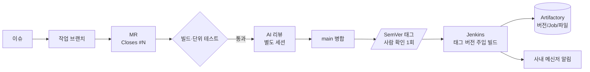

**기간** 2026.06 ~ 현재 · **역할** 파이프라인 운영·장애 대응·워크플로우 설계

> **기여도** — Jenkins·JFrog 운영과 장애 대응 100% 본인. Jenkins 공용 라이브러리(커밋 2/2), 개발 워크플로우 템플릿(커밋 3/3)도 전부 본인 작성. 각 제품 저장소의 Jenkinsfile은 개발팀과 함께 관리.

## 구성

Jenkins(Docker)로 제품 빌드 Job 6~7개를 돌리고, 산출물은 JFrog Artifactory에 `버전/Job/파일` 규칙으로 올립니다. 빌드 결과는 사내 메신저로 알림이 갑니다.

## 문제와 해결 (요약)

| 문제 | 원인 | 해결 |
|---|---|---|
| 아티팩트 저장소 전체 기동 실패 | 7.98부터 내장 Derby DB 거부 | 전용 PostgreSQL로 이전 |
| Jenkins 업로드 403 | 저장소 권한·덮어쓰기 권한 누락 | 권한 추가 |
| 업로드 단계가 산출물을 못 찾음 | Docker 에이전트 안 경로를 플러그인이 인식 못 함 | REST API 업로드로 교체 |
| ARM64 빌드 3연속 실패 | 로그 정리·플랫폼 옵션·캐시 권한 세 겹 | 원인별 수정 |
| 설정을 고쳐도 옛 IP로 동작 | 플러그인이 메모리 값을 다시 파일에 덮어씀 | UI 저장 순서로 절차 정리 |
| 리뷰 규칙이 문서에만 있음 | 지킬 수 없는 필수 조건, 기능이 없는 GitLab 버전 | 지킬 수 있는 조건만 필수로 두고 흐름 단순화 |

## 해결한 장애 (상세)

**아티팩트 저장소가 통째로 안 뜸**
Artifactory 7.98부터 내장 Derby DB를 거부해서 전 서비스가 연쇄로 실패했습니다. 전용 PostgreSQL로 옮겨 해결했습니다.

**Jenkins → 저장소 업로드 실패 (2건)**
- 403 오류: build-info 저장소 권한과 덮어쓰기 권한이 빠져 있었습니다.
- 업로드 단계가 Docker 에이전트 안의 산출물 경로를 찾지 못했습니다. 플러그인 대신 REST API(`curl -T`)로 올리도록 바꾸고, 자격증명은 `withCredentials`로 주입했습니다.

**ARM64 빌드 3연속 실패**
원인이 세 겹이었습니다.
1. 테스트 단계의 로그 정리가 수정 시각이 같다는 이유로 방금 만든 산출물 zip까지 지웠습니다. → 최신 파일 보호
2. Docker 파이프라인이 `--platform` 옵션을 넘기지 않아 이미지 아키텍처가 맞지 않았습니다. → binfmt 설치와 ARM64 툴체인 준비 단계 추가
3. PyInstaller 캐시 폴더 권한 오류가 났습니다. → `HOME`을 워크스페이스로 지정

**서버실 이전 후 옛 IP 정리**
전역 설정, 환경변수, Job 6개의 git 주소를 고쳤습니다. 이때 알게 된 점이 있습니다. 일부 플러그인은 설정 파일을 고쳐도 반영되지 않고, UI에서 저장을 누르면 메모리에 있던 옛 값이 파일을 다시 덮어씁니다. 그래서 UI에서 고치는 순서로 절차를 정리했습니다.

## 개발 워크플로우 개편

기존 흐름은 `feature → develop → verify → main` 4단계였는데, verify는 같은 빌드를 반복할 뿐이었습니다. main 리뷰는 필수라고 적혀 있었지만 실제로는 하지 않았습니다.

바꾼 흐름은 다음과 같습니다.
- `main` + 작업 브랜치(`<type>/<이슈번호>-<설명>`) + SemVer 태그 릴리스
- 필수 조건은 실제로 지킬 수 있는 두 가지만 둠: 빌드와 단위 테스트 통과
- 작성 세션과 분리된 AI 코드 리뷰를 절차에 포함
- MR 본문의 `Closes #N`으로 이슈 자동 종료

릴리스에서 사람이 할 일은 **태그 확인 한 번**입니다. 그 뒤로 Jenkins가 태그 버전을 주입해 빌드하고, 저장소 업로드와 메신저 알림이 자동으로 이어집니다. 이 흐름을 템플릿 저장소와 Claude Code 스킬로 만들어 다른 프로젝트에도 그대로 쓸 수 있게 했습니다.
