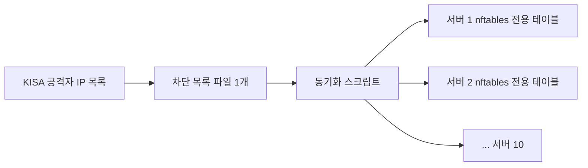

**기간** 2026.10.27 ~ 10.28 · **역할** 영향 판단·차단·업그레이드·점검 단독

> **기여도 100%** — 영향 판단, 긴급 차단, 야간 업그레이드, 점검 보고 전부 본인 (작업 기록 기준).

## 배경

인증 없이 원격 코드 실행이 가능한 GitLab 취약점(CVSS 10.0)이 공지됐고, 사내 GitLab 버전이 해당됐습니다. 사내 소스 코드 전체가 걸린 문제라 당일 대응이 필요했습니다.

## 조치

**1단계: 바로 막기**
- 진입 nginx 2대에 IP 허용 목록을 걸어 외부 접근을 막았습니다. 휴대폰 LTE로 접속해 403이 나오는지 확인했습니다.
- 외부인 자체 가입을 껐습니다.

**2단계: 업그레이드 (야간, 약 2시간 15분)**
- GitLab은 메이저 버전을 건너뛸 수 없어서, 공식 업그레이드 경로대로 **8단계**를 차례로 올렸습니다.
- 내장 PostgreSQL도 14 → 16 → 17로 같이 올라갔습니다.
- 중간에 백그라운드 마이그레이션 1건이 실패했습니다. 원인 파티션을 임시로 붙였다 떼는 방식으로 해결하고 다음 단계로 넘어갔습니다.
- 마지막에 `gitlab:check` 실패 0건, 저장된 비밀값 복호화 실패 0건을 확인했습니다.

**3단계: 점검 결과 정리**
업그레이드하면서 계정 인증, 프로젝트 공개 범위, 접근 토큰, 웹훅 설정까지 함께 점검했고, 개선이 필요한 항목을 우선순위와 함께 권고안으로 정리해 보고했습니다.

## 문제와 해결

| 문제 | 원인 | 해결 |
|---|---|---|
| 한 번에 최신 버전으로 못 올림 | GitLab은 메이저 버전을 건너뛰는 업그레이드를 지원하지 않음 | 공식 경로대로 8단계를 하룻밤에 차례로 진행 |
| 업그레이드 중간에 멈춤 | 백그라운드 마이그레이션 1건이 실패 | 원인 파티션을 임시로 붙였다 떼서 마이그레이션 완료 후 다음 단계 진행 |
| 업그레이드 동안 외부 공격 노출 | 취약 버전이 인터넷에 열려 있음 | 업그레이드 전에 진입 nginx에서 IP 허용 목록으로 먼저 차단 |
| Docker 공개 포트에 방화벽 규칙이 안 먹음 | Docker 포트는 FORWARD 경로라 firewalld zone 규칙을 비켜 감 | nftables 전용 테이블로 IP 차단 |

## 함께 운영하는 보안 작업: 공격자 IP 차단

KISA에서 받은 공격자 IP 목록을 서버 10대 전부에 적용했습니다. 목록 파일 하나를 고치면 동기화 스크립트가 각 서버의 nftables 전용 테이블에 반영하는 방식입니다.

firewalld ipset을 쓰지 않은 이유가 있습니다. 서버마다 방화벽 구성이 달라 한 가지 방식으로 통일하기 어려웠고, Docker가 공개한 포트는 FORWARD 경로를 타서 firewalld zone 규칙을 비켜 갑니다. 적용 전에는 접속 기록에서 해당 IP 흔적이 있는지 먼저 점검했습니다(일치 없음).
