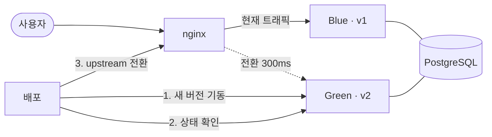
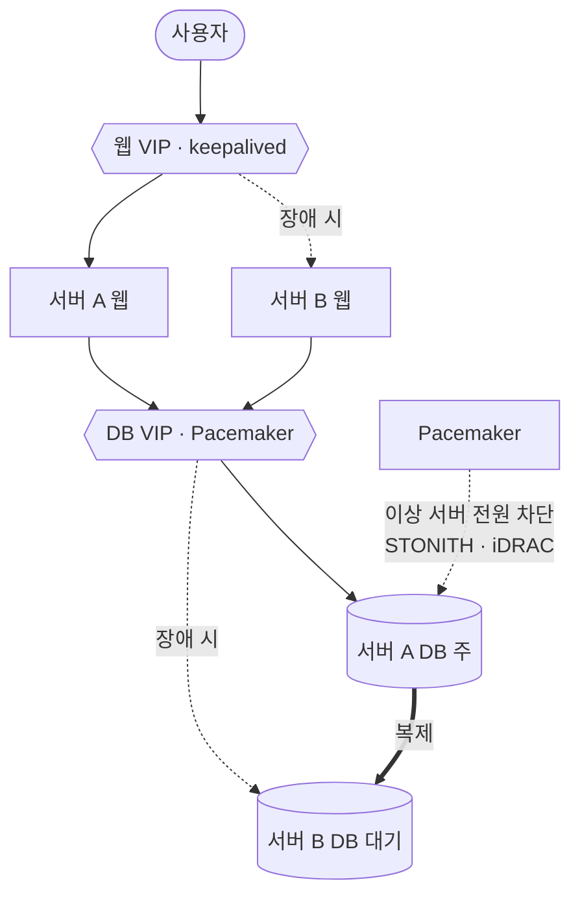

**기간** 2026.08.20 ~ 09.09 · **역할** 설계·구축·시험 단독

> **기여도 100%** — 저장소 커밋 36/36, 변경 57,699줄 전부 본인 작성.

## 배경

사내 관리 대시보드(Spring Boot + PostgreSQL)는 서버를 재부팅하면 **162.5초** 동안 멈췄습니다. 그동안 502 응답이 32번 났고, 목표(30초)의 5배가 넘었습니다.

## 1차: Blue-Green 배포

같은 앱 두 벌(Blue, Green)을 띄워 두고, 새 버전을 쉬는 쪽에 올린 뒤 nginx upstream만 바꿔 트래픽을 넘깁니다.

배포·롤백을 각각 3번씩 실측했습니다.

| 항목 | 결과 |
|---|---|
| 전환 시간 | 300ms |
| 배포 중 지속 호출 | 1,203회 전부 200 응답 |
| 최장 무응답 | 0ms |
| 롤백 | 최대 12.2초 |
| (비교) 그냥 재시작 | 8.9초 중단 |

## 2차: 서버 2대 이중화

- 웹: keepalived VIP
- DB: Pacemaker가 관리하는 VIP + iDRAC 전원 제어(STONITH)로, 이상한 서버를 확실히 꺼서 두 서버가 동시에 주가 되는 일을 막습니다.

서버 전원을 실제로 3번 끊어 봤습니다.
- 자동 이어받기 최대 11초 (기준 30초)
- 사용자 화면 중단 최대 3.4초

## 문제와 해결

| 문제 | 원인 | 해결 |
|---|---|---|
| 재부팅 시 162.5초 중단 (502 32회) | 앱이 한 벌뿐이라 재시작하는 동안 받을 곳이 없음 | Blue-Green으로 두 벌을 두고 nginx upstream 전환 → 300ms |
| DB 서버 2대가 동시에 주가 될 위험 | 2노드 구성은 상대가 죽었는지 확실히 알 수 없음 | iDRAC 전원 제어(STONITH)로 이상 서버를 확실히 끈 뒤 이어받음 (차단 7.86초) |
| 시험 중 지표 55,238행 손실 | 삭제 방어 시험을 운영 데이터에서 진행 | 아래 참고 |

## 배운 점

데이터 삭제 방어를 시험하다가 지표 데이터 55,238행을 실제로 잃었습니다. 시험용 데이터와 운영 데이터를 분리하지 않은 것이 원인이었습니다. 이후 삭제는 DB, API, 화면 세 곳에서 막도록 바꿨고, 파괴적인 시험은 반드시 복제본에서 합니다.
