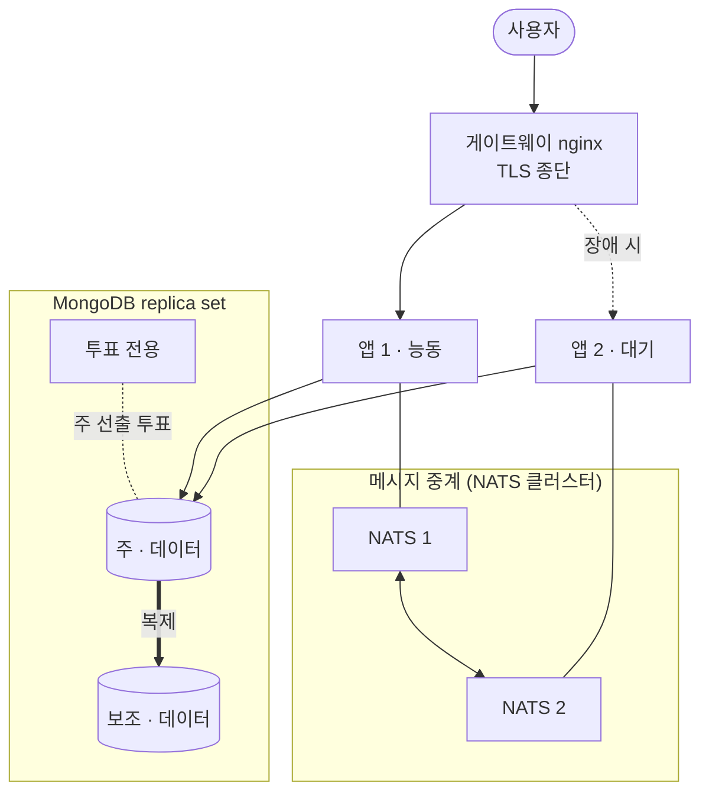

**기간** 구축 2026.07 · 이중화 2026.09.04 ~ 09.11 · **역할** 구축·이중화·장애 분석 단독

> **기여도 100%** — 구축·이중화·원인 분석·사용자 가이드 전부 본인. 배포 설정 저장소 커밋 2/2, 변경 1,367줄 전부 본인 작성.

## 구축

Rocket.Chat 8.6, MongoDB 8.0(replica set), NATS를 Docker Compose로 올리고, 게이트웨이 nginx에서 TLS를 종단했습니다. 인증서는 acme.sh DNS-01 방식 와일드카드로 자동 갱신합니다. 서버실 이전 후 다시 검증해 배포 가이드를 v2.0으로 고쳤고, 전 직원용 접속 가이드와 안내 메일도 만들었습니다.

GitLab 웹훅과 Jenkins 공용 라이브러리를 연결해, 빌드 결과와 MR 소식이 메신저로 오게 했습니다.

## 이중화

메신저 서버 한 대가 죽으면 채팅이 통째로 끊기는 구조였습니다. 새 서버 없이 기존 서버에 나눠 얹었습니다.

- 앱 2대, DB 3멤버(데이터 2 + 투표 전용 1)
- NATS 2대 클러스터: 처음 계획은 1대 공유였는데, 그 1대가 새 단일 장애점이 되어 바꿨습니다.
- 게이트웨이는 **능동-대기** 방식: 평소 접속을 두 서버에 나누면 장애 때 어느 로그를 봐야 할지 흐려지기 때문입니다.

진행은 사전 점검 → 데이터 이중화 → 앱 이중화·전환 시험 → 감시 순서로 4단계로 나눴습니다.

## 결과

| 항목 | 결과 |
|---|---|
| 데이터 대조 | 사용자 24, 메시지 28,118, 방 64 등 5종 일치, 복제 지연 0초 |
| 백업 복원 | 82,666건, 실패 0 |
| DB 주 역할 전환 | 2초 (68회 표본 중 오류 0) |
| 앱 45초 정지 중 | 게이트웨이 오류 응답 0회 |
| 재기동 시험 | 222회 표본 중 오류 0 |

## 문제와 해결

| 문제 | 원인 | 해결 |
|---|---|---|
| 이중화 설계안에 새 단일 장애점이 생김 | 메시지 중계(NATS)를 1대로 공유하는 원안 | NATS 2대 클러스터로 설계 변경 |
| 모니터링 지표가 사실상 비어 있음 | 지표 수집기가 지표 2개만 내보내고 있었음 | 수집기 설정 정상화 → 11,087개 |
| 재부팅 후 일부 컨테이너가 안 뜸 | 컨테이너 3종에 재시작 정책 없음 | 재시작 정책 추가 |
| 원격 전원 제어(iDRAC)가 안 됨 | 주소, NIC 모드, LAN 채널 세 곳이 모두 막혀 있었음 | 세 설정을 하나씩 찾아 열고 원격 제어 확인 |
| 서버 디스크 가득 참 → 메신저 약 3시간 중단 | 다른 서비스 이전 직후 디스크 부족 (본인 작업 원인) | 정리 후 사용률 85% → 35%, 유실 0. 이후 이전 전 디스크 여유 확인을 절차에 넣음 |
| 이중화 직후 "글이 사라졌다" 신고 | 아래 원인 분석 참고 (사용자 삭제) | 삭제 이력 보존 설정 진행 |

## 메시지 유실 신고 원인 분석

이중화 직후 "전날 글이 사라졌다"는 신고가 들어왔습니다. 이중화 탓으로 보이기 쉬운 상황이었는데, DB 연산 기록(oplog)을 따라가 보니 결론이 달랐습니다.

- 명시적 삭제 연산이 있었고, 이중화 작업보다 2시간 43분 앞섰습니다.
- 25초 사이 12건이 2~3초 간격으로 지워졌습니다. 사람이 화면에서 하나씩 지운 패턴입니다.
- 복제 되감기 흔적이 없었고, 두 서버의 데이터 5종이 일치했습니다.

판정은 **이중화와 무관한 사용자 삭제**였습니다. 같은 일이 생겼을 때 바로 확인할 수 있도록 삭제 이력 보존 설정을 켜는 조치를 진행했습니다.

## 배운 점

장애 신고가 들어오면 직전에 한 작업을 먼저 의심하게 됩니다. 이번에는 DB 연산 기록이라는 객관적인 근거를 따라가서 이중화와 무관하다는 것을 확인했고, 덕분에 멀쩡한 구성을 되돌리지 않았습니다. 반대로 디스크 장애는 제 작업이 원인이었는데, 이것도 숨기지 않고 기록해 이전 절차를 고쳤습니다.
