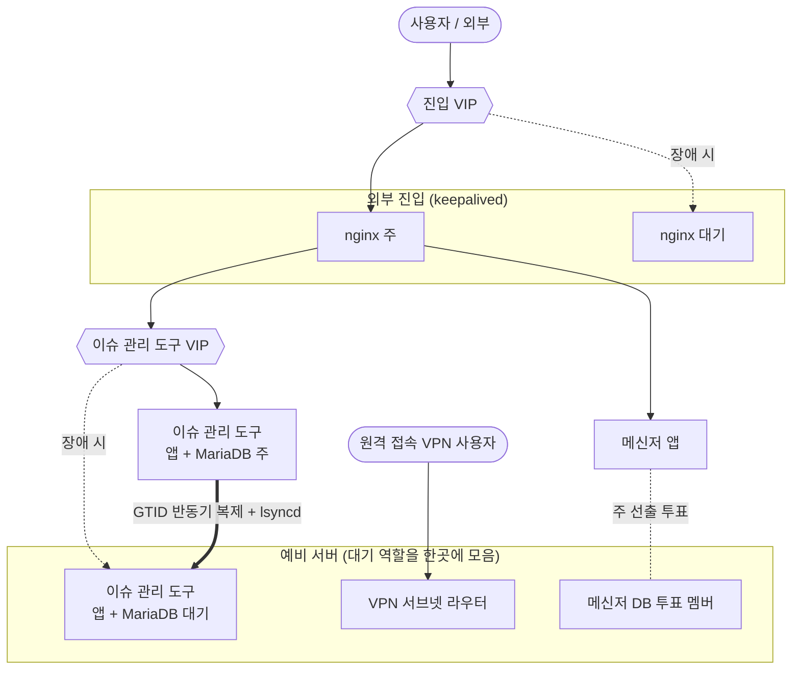

**기간** 2026.09.14 ~ 09.18 (구축 2일, 시험 4일) · **역할** 설계·구축·시험·보고 단독

> **기여도 100%** — 설계·구축·시험·결과서 전부 본인. 이중화 설정·스크립트 저장소 커밋 4/4, 변경 16,451줄 전부 본인 작성.

## 배경

사내 서비스의 외부 진입로(모든 도메인), 이슈 관리 도구(Yona), VPN 서버망 경로가 전부 서버 한 대씩에만 있었습니다. 특히 한 서버가 이슈 관리 도구 주 서버, 메신저 앱 주 서버, 메신저 DB 주 서버를 동시에 맡고 있어서 이 서버가 멈추면 업무 대부분이 멈췄습니다. 원격 전원 제어가 안 되는 서버도 있어 장애 시 현장 출동이 필요했습니다.

조건은 **장비·소프트웨어 구매 없이 기존 서버로** 해결하는 것이었습니다.

## 설계

| 대상 | 구성 |
|---|---|
| 외부 진입 | nginx(L7) 2대 + keepalived VIP, 짧은 주기 상태 검사. 외부 트래픽이 VIP로 들어오도록 전환 |
| 이슈 관리 도구 | MariaDB GTID 반동기 복제 + lsyncd 파일 동기화 + keepalived VIP |
| VPN 경로 | 서버망으로 들어가는 경로(서브넷 라우터)를 예비 서버로 옮겨 이중화 |
| 메신저 | 주 서버를 다른 서버로 재배치, 투표 전용 DB 멤버 이동 |

> 구성도는 역할 단위로 일반화했습니다. 실제 주소·서버 배치는 싣지 않습니다.

선택 기준은 두 가지였습니다.

- **주는 흩고 대기는 모은다.** 대기 역할을 주 서버에 얹으면 그 서버가 죽을 때 서비스와 예비를 같이 잃습니다. 그래서 주 역할이 없고 원격 전원 제어가 되는 서버 한 대에 대기를 모았습니다.
- **이슈 관리 도구는 자동 복귀를 하지 않는다.** DB와 첨부 파일이 따로 동기화되기 때문에, 자동으로 되돌리면 대기 쪽에 쌓인 기록을 잃을 수 있습니다. 복귀는 절차서에 따라 사람이 합니다.

## 결과

서버를 실제로 끄거나 서비스를 강제로 내려서 끊김 시간을 쟀습니다.

| 시험 | 끊김 |
|---|---|
| 진입 서버 keepalived 정지 | 1초 |
| 진입 서버 nginx 정지 | 5초 |
| 회선 단절 | 0초 |
| 이슈 관리 도구 주 서버 전원 차단 | 약 26초 |
| 메신저 DB 주 서버 전원 차단 | 21초 |
| 예비 서버 전원 차단 | 0초 (서비스 영향 없음) |

- 데이터 손실 0건, 메신저 주 재선출 공백 1.2초
- 점검 스크립트 2종 작성 (16/16, 12/12 통과)
- 결과서·장애 대응 절차서 작성 후 대면 보고

## 남은 한계

시험에서 기대와 다르게 동작한 항목은 성공한 결과와 똑같이 결과서에 적고, 원인 분석과 개선안을 붙여 후속 과제로 넘겼습니다. 좋은 수치만 보고하면 다음 담당자가 같은 함정에 빠지기 때문입니다.

## 문제와 해결

| 문제 | 원인 | 해결 |
|---|---|---|
| 첫 전환 시험에서 대기 서버의 이슈 관리 도구가 기동 실패(203/EXEC), 약 4분 중단 | SELinux(Enforcing)가 keepalived 전용 라벨 디렉터리에 둔 점검 스크립트를 systemd가 실행하지 못하게 막음 | 스크립트를 `/usr/local/sbin`으로 옮기고 systemd drop-in 경로 수정 → 재시험에서 정상 승격 |
| 진입 서버 전환 직후 메신저 외부 접속 약 2분 불통 | 새 진입 서버가 앱 포트로 직접 붙는데, 앱 서버 방화벽(DOCKER-USER)이 옛 게이트웨이만 허용 | 허용 목록에 새 진입 서버 추가 후 복구. 사전 조회에서 이미 기록해 둔 사실이었는데 배포 전 조치 목록에 옮기지 않은 실수라, 이후로는 조회 결과를 체크리스트로 바로 옮김 |
| 파일 동기화(lsyncd)가 SSH 오류(255)로 실패 | `ssh.options`를 목록 형식으로 써서 `-o 1=…` 같은 잘못된 인자로 넘어감 | key=value 표 형식으로 수정 |
| 동기화 후 저장소가 깨짐 | `*.lock` 제외 규칙 때문에 저장소에 꼭 필요한 `db.lock` 파일이 빠짐 | 제외 규칙 삭제, 초기 복사 후 digest 일치 확인 |
| 복제 설정이 거부됨 | 덤프를 적재하면서 대기 DB에 자체 GTID가 생겨 시작 위치 지정이 막힘 | 적재 후 `RESET MASTER`를 거쳐 GTID 기반 복제 연결 |

두 사고 모두 사용자가 없는 야간에 났고 데이터 손실은 없었습니다. 그래도 이 일 이후로는 전환 전에 되돌리는 절차를 먼저 시험해 보고 진행합니다.
